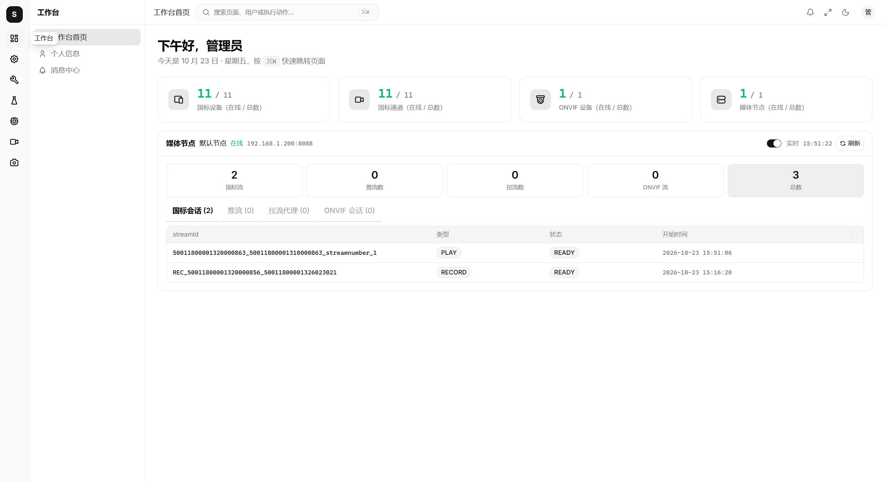
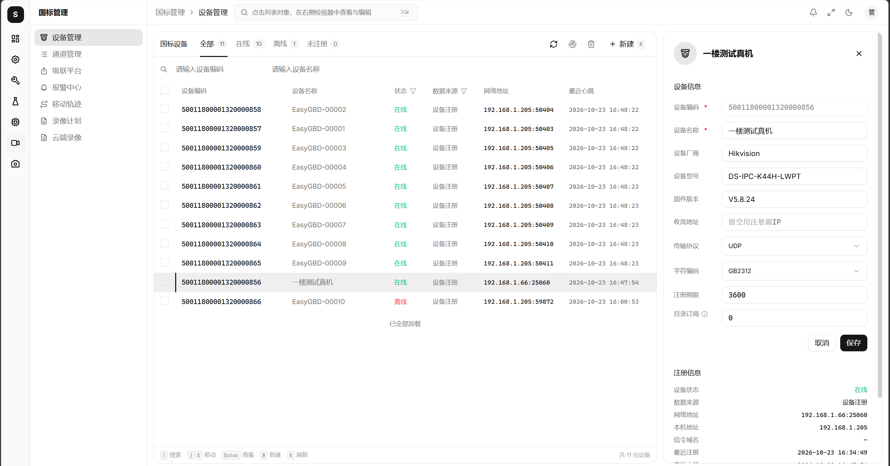
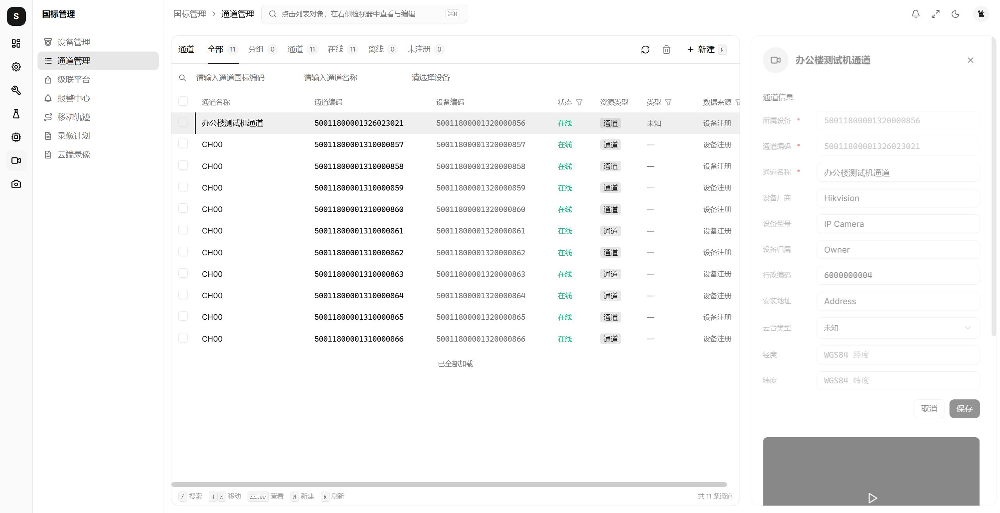
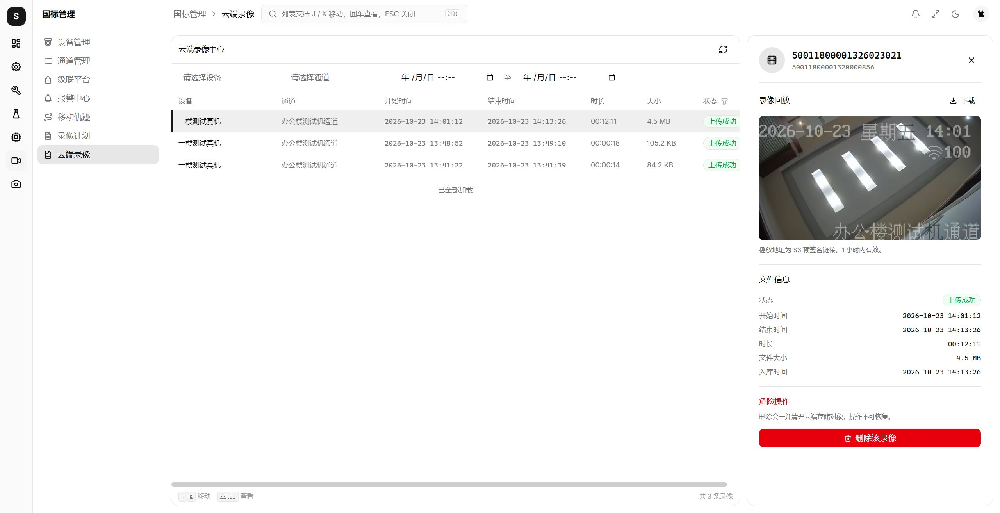
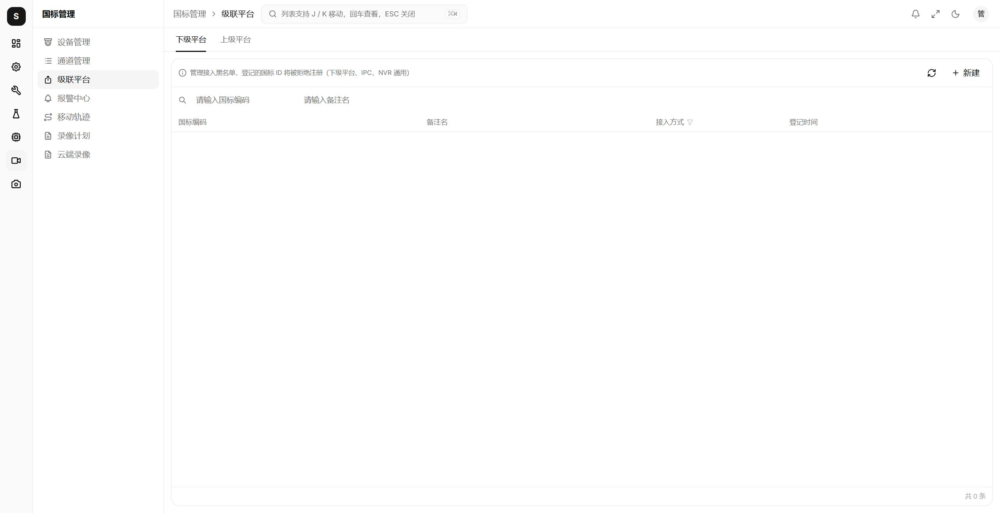
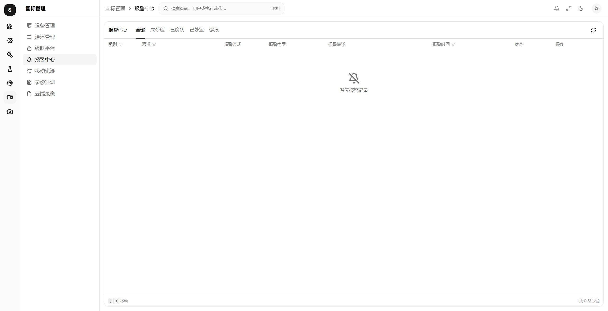
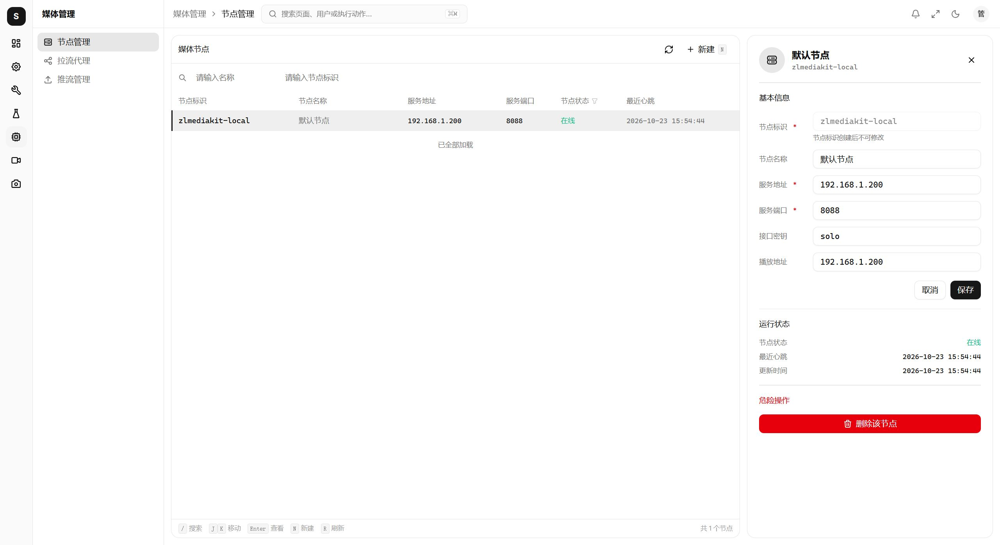
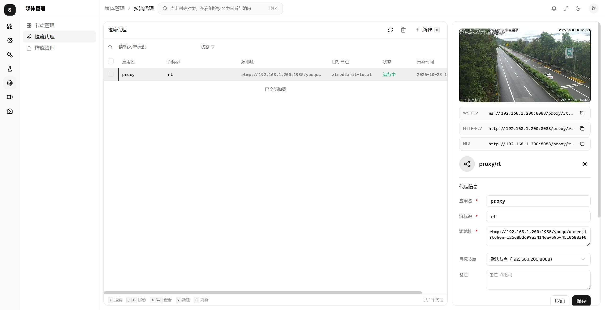
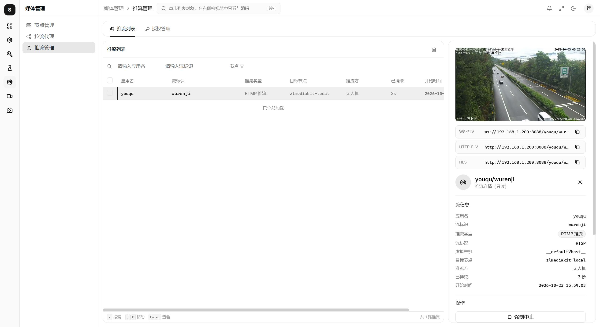
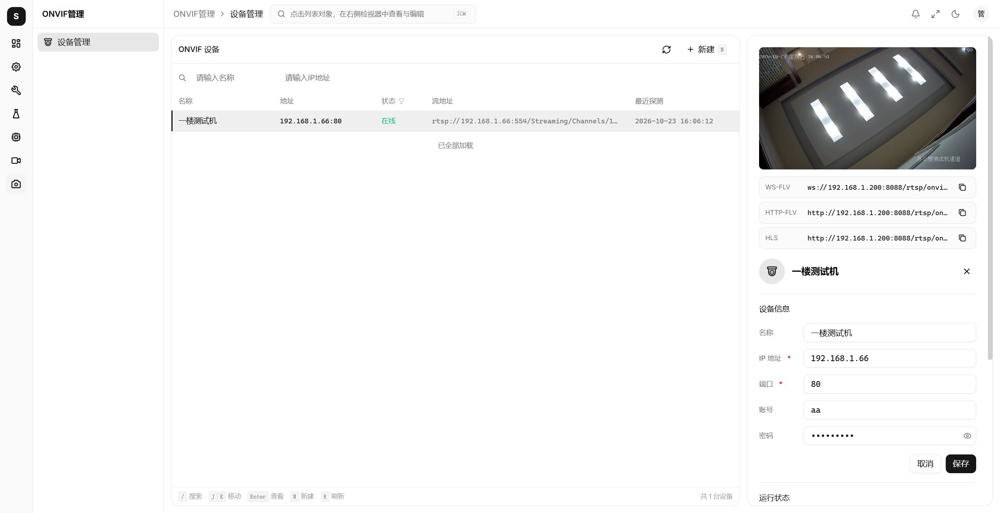

<div align="center">

# Solo 视频监控平台

**基于 GB/T 28181-2016 国标的轻量级视频监控接入与流媒体管理平台**

自研 SIP 协议栈接入国标设备 · ZLMediaKit 流媒体分发 · 国标级联 · 现代化管理控制台

<br/>

[](LICENSE)
[](https://adoptium.net/)
[](https://spring.io/projects/spring-boot)
[](https://vuejs.org/)
[](https://www.typescriptlang.org/)
[](https://github.com/ZLMediaKit/ZLMediaKit)
[]()

**仓库地址**：[Gitee（主仓库）](https://gitee.com/heguangchuan/solo-platform) · [GitHub（镜像，同步更新）](https://github.com/heguangchuan/solo-platform)

</div>

---

### 写在前面

最近很忙啊  没时间更新了  手里的相机有限  有人一起参与吗  后面的计划大概是多实例之类的........    语音对讲还没调通啊,5555555555555...............

Solo 是一套**开箱即用**的国标视频监控平台：从设备注册鉴权、目录同步、实时点播、录像回放下载、云台控制，到多级平台级联、多流媒体节点负载均衡，覆盖 GB/T 28181 全链路。后端采用 Java 21 + Spring Boot 4 全新自研，代码结构清晰、注释完整、无历史包袱；前端提供现代化的 shadcn 风格管理控制台。

```
设备/平台(GB28181)
      │  SIP(UDP/TCP) :5060
      ▼
┌─────────────────────────────┐
│   Solo Platform（后端）      │
│  注册鉴权 · 目录 · 点播信令   │
│  回放下载 · 云台 · 报警 · 级联 │
└───────────┬─────────────────┘
            │ REST + Hook
            ▼
┌─────────────────────────────┐
│   ZLMediaKit（流媒体节点）    │  ──► HTTP-FLV / WS-FLV / HLS / WebRTC
│  收流 · 转封装 · 分发 · 录像  │
└───────────┬─────────────────┘
            ▼
   MySQL / PostgreSQL · Redis
```

## 界面截图

以下截图均来自真实环境（一楼测试真机 + EasyGBD 模拟设备），更多页面可本地启动后浏览。

### 工作台首页

设备 / 通道 / 流媒体节点运行总览，实时会话状态一目了然。



### 国标设备管理

设备注册状态、在线 / 离线、网络地址、最近心跳一目了然，点击任意设备在右侧检视器中查看详情。



### 通道管理

按设备分组管理所有国标通道，支持通道名称、编码、云台类型、数据来源等多维度筛选。



### 云端录像中心

ZLM 本地落盘，平台登记文件位置并签发限时访问链接，按设备 / 通道 / 时间 / 状态多维检索，在线播放与下载。



### 国标级联

支持上级平台与下级平台双向级联：作为下级向上级注册共享目录，作为上级接入下级平台并订阅目录变化。



### 报警中心

统一接收设备报警事件（移动侦测、视频遮挡、硬盘满等），按时间 / 设备 / 报警类型过滤查询。



### 流媒体节点管理

多 ZLMediaKit 节点统一管理，支持在线状态、心跳检测、负载均衡调度。



### 拉流代理

一键拉取外部 RTSP / RTMP / FLV / HLS 流到平台分发，自动转封装输出多协议播放地址。



### 推流管理

第三方推流接入与授权管理，支持 RTMP 推流实时监控与鉴权。



### ONVIF 设备接入

自动发现与手动添加 ONVIF 协议设备，自动探测 RTSP 流地址并转封装分发，支持鉴权配置。



> 此外还提供 **移动轨迹（GPS）**、**云台控制（含预置位 / 巡航）**、**录像回放与倍速下载** 等功能模块，可本地启动后逐一体验。

## 定位与边界

Solo 定位为**视频能力底座（中台）**：专注把 GB/T 28181 设备接入与流媒体分发封装成稳定、标准化的 **REST API + 标准播放地址（HTTP-FLV / WS-FLV / HLS / WebRTC）**，供上层业务系统集成。它是一个"能力提供方"，而不是一个开箱即用的行业业务成品。

**平台提供（底座职责内）**

- 设备注册鉴权、目录同步、实时点播、录像回放 / 下载、云台控制、报警事件、GPS 移动位置、语音广播、国标级联
- 多流媒体节点负载均衡、拉流代理、推流鉴权
- 用户与登录认证等基础支撑能力

**平台不做（由业务系统自行实现）**

- **监控大屏、电子地图打点 / 轨迹可视化**等呈现层
- **多画面分屏、电视墙、分组轮巡**等播放编排
- **录像计划编排与保留策略**：由业务系统实现，平台仅提供开始录制 / 停止录制 / 查询录制态的 OpenAPI
- 人脸识别、客流统计、智能分析等行业业务逻辑
- 面向具体客户的业务流程与页面定制

> 业务系统无需关心 SIP 信令与设备差异，直接调用平台接口获取播放地址、订阅报警 / 状态事件即可完成自身业务闭环。

## 功能特性

### 视频监控（GB/T 28181 国标）

- **设备接入**：SIP 注册 Digest 鉴权（配置密码时校验用户名、realm、请求 URI、平台签发的 nonce 与响应摘要，鉴权失败不修改设备状态；nonce 有效期 5 分钟，密码留空为仅限隔离测试环境的开放模式）、心跳保活、在线状态实时维护（Redis TTL + 定时对账）
- **通道目录**：注册后自动拉取 Catalog，分片合并入库，支持超大目录；设备信息（厂商/型号/固件）自动同步
- **实时点播**：主/子码流切换，UDP / TCP 被动 / TCP 主动三档收流；HTTP-FLV / WS-FLV / HLS / WebRTC 多协议播放；播放地址携带绑定节点、流和协议的限时签名令牌；按需拉流（无观看自动断流节能）
- **历史回放**：录像检索、时间轴回放、暂停 / 续播 / 拖动 / 倍速（SIP INFO + MANSRTSP）
- **录像下载**：DOWNLOAD INVITE 倍速下载，MP4 由 ZLM 本地落盘，平台签发限时链接下载
- **云端录像**：按通道配置周计划（支持 7×24、跨午夜时段），定时对账自动拉起 / 停止录制，MP4 切片由 ZLM 本地落盘并经 hook 登记；云端录像中心支持按设备 / 通道 / 时间 / 状态检索、在线回放、限时链接下载、保留期自动清理；READY 会话周期性探测 ZLM 真实录制态（isRecording），外部误调 stopRecord 或 ZLM 丢录制态时自动补发 startRecord
- **云台控制**：八方向 + 变倍 + 聚焦 + 光圈 + 雨刷；预置位管理；巡航路线（巡航点编排、速度/停留时间、启停）；拉框放大/缩小（画面上直接框选）、看守位（预置位面板内设置）
- **设备控制**：布防 / 撤防、报警复位、设备本地录像开关、强制关键帧、远程重启（重启单独授权）
- **报警中心**：报警落库、历史查询与前端处置闭环
- **移动位置**：GPS 位置上报解析、事件总线、轨迹点异步落库、历史轨迹查询与保留期清理
- **语音广播**：浏览器麦克风经 WebRTC 实时喊话，平台发广播通知后接收设备反向 INVITE，音频按设备协商的 PCMA/PS 载荷裸 RTP 推送给设备放音；兼容反向 INVITE 不带 Subject 的设备（如海康），UDP / TCP 主动 / TCP 被动三种传输自适应
- **主动检测**：设备存活 fire-and-forget 探测，三态回调校准在线状态

### 国标级联

- **作为上级**：下级平台禁用名单管理（设备与下级平台默认自由注册，仅在名单登记且禁用的国标 ID 会在 SIP 入口拦截），下级注册后视为设备接入，通道目录自动入库、按周期发起目录订阅并自动续期，可直接点播 / 回放下级通道
- **作为下级**：注册保活到上级平台（401 Digest 应答、掉线自动重注册），资源共享目录树勾选推送，响应上级 Catalog / DeviceInfo / DeviceStatus 查询（分片）；接收上级目录 / 移动位置 / 报警订阅（SUBSCRIBE）并维护订阅状态，目录变化、GPS 位置、报警均主动 NOTIFY 推送、支持手动主动推送；被上级点播时经 ZLM sendRtp 主动推流；上级 DeviceControl 控制指令（PTZ 云台 / 布防 / 报警复位 / 录像 / 强制关键帧 / 远程启动 / 拉框放大缩小 / 看守位）经共享校验后透传给真实设备

### 流媒体（ZLMediaKit 集成）

- **多节点负载均衡**：Redis ZSet 按活跃流数智能选点，SSRC 池 Redis 化，多实例部署安全
- **拉流代理**：外部 RTSP/RTMP 流拉入 ZLM 转推，启停管理、播放地址自动生成
- **推流管理**：推流只读视角 + 推流方 token 鉴权，僵尸流自动对账清理
- **自动点播**：持有有效播放令牌的地址被访问但流不存在时自动补发 INVITE；无令牌、错误令牌、过期令牌和跨目标令牌均拒绝播放且不会触发 INVITE
- **播放访问控制**：`wt` 绑定媒体节点、app、stream、schema、传输 protocol（FLV）和有效期，所有环境默认拒绝无有效凭证的播放；HLS m3u8 与直播分片均通过 hook 校验，级联和平台内部 reader 按精确活动会话授权

### 用户与登录认证

- 用户列表、新建、编辑、启停、删除和导出，不区分角色权限
- JWT 双 Token 登录、当前用户资料与修改密码、首次登录强制改密
- 登录限流、XSS 消毒等安全能力

### ONVIF 模块

ONVIF 摄像头维护与实时点播，手写 SOAP（dom4j + Java 21 HttpClient），无 JAX-WS 历史包袱。

## 前端说明

前端代码位于本仓库 `solo-console/` 目录：Vue 3.5 + TypeScript + Vite 6 + Tailwind CSS 4 + shadcn-vue (reka-ui) + Pinia，现代极简风格，覆盖国标设备/通道/级联、点播回放、云端录像、流媒体节点、拉流代理、推流、ONVIF、开放 API 应用与调用日志、用户管理、个人中心等能力，开发端口 `5173`。

## 技术栈

| 端 | 技术 |
|---|---|
| 后端 | Spring Boot 4.1 · Java 21 · MyBatis-Plus 3.5 · JAIN-SIP · jjwt · dom4j · JSch |
| 前端 | Vue 3.5 · TypeScript 5.7 · Vite 6 · Tailwind CSS 4 · shadcn-vue / reka-ui · Pinia · xterm.js · Jessibuca / mpegts.js |
| 基础设施 | MySQL 8 / PostgreSQL · Redis 6+ · ZLMediaKit |

## 快速开始

### 获取代码

```bash
git clone https://gitee.com/heguangchuan/solo-platform.git
cd solo-platform
```

> GitHub 镜像仓库：<https://github.com/heguangchuan/solo-platform>，与 Gitee 同步更新，国内环境建议优先使用 Gitee。

### 环境要求

- JDK 21+、Maven 3.8+、Node.js 18+、Redis 6+
- MySQL 8+ 或 PostgreSQL（二选一，初始化脚本与后端 profile 须保持一致）
- ZLMediaKit（视频功能必需，可用 Docker 部署）

### 1. 初始化数据库

全新部署一个脚本装完（用户 + 国标 + ONVIF + 开放 API + 语音播报）。**两个脚本都会重建全部表，仅用于全新部署，已有数据请先备份。**

**PostgreSQL（默认）**：脚本不会自动创建数据库，先建库再执行：

```bash
psql -U postgres -c "CREATE DATABASE solo_db"
psql -U postgres -d solo_db -f sql/PostgreSQL_solo_db.sql
```

**MySQL**：脚本自动创建 `solo_db` 并设置 `utf8mb4`：

```bash
mysql -uroot -p < sql/MySQL_solo_db.sql
```

### 2. 配置并启动后端

`solo/src/main/resources/application.yaml` 默认设置 `spring.profiles.active: pg`，实际连接信息位于对应 profile 文件：

- PostgreSQL：编辑 `application-pg.yaml`。
- MySQL：将 active profile 改为 `local`，再编辑 `application-local.yaml`。

在对应 profile 文件中检查以下配置：

- `project.*`：平台、数据库、Redis 和 ZLM 的部署地址。
- `spring.datasource` / `spring.data.redis`：数据库与 Redis 连接，须与所选数据库匹配。
- `gb28181.*`：SIP 端口（默认 5060）、平台国标编码、域、注册密码。**生产环境必须设置 `gb28181.password`，留空会进入不校验身份的开放模式。**
- `media.*`：ZLM 节点地址 / 密钥 / 点播超时 / SSRC 段，以及下述强制播放鉴权配置。

播放访问控制在 `pg`、`local`、`mock` 和自定义 profile 中都强制开启，没有环境关闭开关：

```yaml
media:
  play-auth:
    # 建议生产显式配置至少 32 字节的独立随机密钥；留空时兼容回退到 jwt.secret
    secret: ${MEDIA_PLAY_AUTH_SECRET:}
    # 只限制每次播放发起时令牌是否有效，已建立的连接不会到期即断
    token-ttl-seconds: 7200
  view-record:
    # 只控制观看审计落库，不影响播放鉴权
    enabled: true
```

多实例必须共用相同的播放密钥。旧版仅绑定 stream 的令牌和裸播放地址不能用于新起播放；地址过期或重连失败后，重新调用原点播/播放地址 API 获取完整新 URL，不要手工复制或修改 `wt`。

```bash
cd solo && mvn spring-boot:run
```

服务端口 `8080`，SIP 同时监听 UDP/TCP `5060`，等待 ZLM hook 回调。

### 3. 配置并启动 ZLMediaKit

仓库提供一份开箱参考配置 [zlm/config.ini](zlm/config.ini)，复制到 ZLM 的配置目录（与 `MediaServer` 可执行文件同级的 `conf/`）后按需修改三处：

- **Hook 回调地址**：以 `on_stream_changed` 为例，完整写法为 `http://solo.com:8080/api/hook/on_stream_changed?secret=solo`；请将 `solo.com` 改为后端实际可达地址（本地联调可在 hosts 中把 `solo.com` 指向后端 IP），其余 `on_*` 事件同理。**secret 必须作为 URL 查询参数（`?secret=`）带上**，且与本文件 `[api].secret`、后端 `media.hook-secret`（统一 `solo`）三者一致，否则后端 `checkSecret` 会拒绝回调。`on_play`、`on_stream_not_found`、`on_http_access` 是强制播放鉴权链路，部署时不得置空；`on_rtsp_realm` 保持为空，避免 RTSP 专属鉴权绕过 `on_play`。HTTP/WS-FLV 的强制区分优先使用 `on_play` 上报的 `protocol` 字段；旧版 ZLM 缺少该字段时，只在签名有效的 HTTP/WS-FLV 候选目标间匹配，节点、app、流、schema 和有效期等其他绑定维度不放宽。
- **API 密钥**：`[api].secret` 须与后端媒体节点的 `secret` 一致（示例值 `solo`，生产环境请更换）。
- **节点标识**：`[general].mediaServerId`（示例 `zlmediakit-local`）须与后端媒体节点的 `server-id` 完全一致。

关键端口（需与后端媒体节点配置、防火墙放行对应）：

| 端口 | 用途 |
|---|---|
| `8088` | HTTP API / HTTP-FLV / WS-FLV / HLS |
| `554` | RTSP |
| `1935` | RTMP |
| `8000` | WebRTC（TCP/UDP） |
| `10000` | RTP 代理端口（国标 PS 流转发） |
| `9000` | SRT |

> 另需保证 ZLM 所在机器安装了 ffmpeg（示例中 `[ffmpeg].bin=/usr/bin/ffmpeg`，Linux 路径；Windows 请改为实际路径）。

### 4. 启动前端

```bash
cd solo-console && npm install && npm run dev
```

访问 `http://127.0.0.1:5173`，`/api` 已代理到 `localhost:8080`。本地体验账号 `admin / admin123`（**生产环境请务必修改默认密码**）。

### 5. 接入摄像头

将国标设备（海康/大华/宇视等）的 SIP 服务器指向部署机 `IP:5060`，协议 ID 填当前生效 profile 中的 `gb28181.id`，域填 `gb28181.domain`。设备注册成功后平台自动拉取通道目录，即可点播。

**注册鉴权：**

- 生产环境在 `gb28181.password` 设置平台级统一注册密码，设备／下级平台的注册密码必须与其一致。当前不支持按设备分别设置 SIP 密码。
- 配置密码后，首次 REGISTER 返回 401 属于正常 Digest 挑战流程；设备随后携带摘要重新注册，平台会校验设备 ID、realm、请求 URI、nonce 和响应摘要，注册与注销都需通过鉴权。
- 平台签发的 nonce 保存在 Redis，有效期 5 分钟。设备持续收到 401 时，优先检查设备 ID、SIP 域、注册密码及设备 Digest 兼容性；鉴权失败不会改写设备地址或在线状态，也不会注销现有会话。
- `gb28181.password` 留空表示不挑战、不校验的开放模式，**仅限网络隔离的测试环境使用，不能作为生产配置**。

> **重启后端不会中断正在播放的流**：ZLM 和设备之间的 RTP 推流跟后端进程无关。启动时会把 Redis 里残留的会话逐个探活：ZLM 上流还在的原样接管，停止/回放控制照常可用；流已经没了、承载节点不在了，或者下载任务这类进程内状态续不上的，才会清掉。

## 项目结构

```
solo-platform/
├── solo/                  # Spring Boot 后端（端口 8080）
│   └── src/main/java/com/solo/
│       ├── system/        # 用户 / 登录认证
│       ├── gb28181/       # 国标 SIP 协议栈与设备/级联/回放/云台业务
│       ├── media/         # ZLM 客户端 / Hook / SSRC 池 / 拉流代理 / 推流
│       ├── onvif/         # ONVIF 摄像头
│       ├── openapi/       # 开放 API（HMAC 签名鉴权 / 应用管理 / 实时点播 / 调用审计）
│       ├── aop/           # 登录限流
│       └── config/        # JWT / Redis / MyBatis-Plus / 安全头
├── openapi/               # 第三方对接资料（Bruno 前置签名脚本，见下方对接指南）
├── solo-console/          # Vue 3 控制台（Vite + Tailwind + shadcn-vue，端口 5173）
├── zlm/                   # ZLMediaKit config.ini 示例（hook / 端口 / 录像参考配置）
└── sql/                   # MySQL / PostgreSQL 首次部署合并脚本（会重建全部表）
```


## 国标不计划实现清单

> 记录 GB/T 28181 标准中有定义、但本项目不计划实现的能力，并说明原因。
> 后续有新的决策可继续补充到本表。

| 功能 | 说明 | 未实现原因 |
|---|---|---|
| 配置查询与下发(DeviceConfig) | 远程查询或修改设备视频参数、OSD、网络、云台等配置 | 各厂商差异大、兼容性差；远程改网络/端口风险高 |
| ConfigDownload 配置下载 | 下载设备完整配置文件，用于备份/恢复/克隆 | 各厂商 schema 不兼容、跨品牌无法复用 |
| Query/Alarm 报警查询 | 平台主动向设备查询历史报警记录 | 报警靠 Notify 推送、平台已有报警库 |
| 报警主动订阅 | 平台主动向设备发起报警订阅，约定有效期和上报方式 | 明确不做。主流设备默认 Notify 即能收到 |

## 路线图

### 已完成

- [x] 设备注册鉴权 / 目录同步 / 实时点播 / 录像回放下载 / 云台（预置位 + 巡航）
- [x] 报警落库、历史查询与处置
- [x] GPS 移动位置落库、历史轨迹查询与保留期清理（轨迹可视化由业务系统实现）
- [x] 国标级联（作为上级 / 作为下级，目录共享、订阅推送、被点播推流、上级 DeviceControl 透传）
- [x] 云台拉框缩放 / 看守位（后端接口 + 前端入口）
- [x] 多 ZLM 节点负载均衡 / SSRC Redis 化 / 拉流代理 / 推流鉴权
- [x] ONVIF 摄像头接入与点播
- [x] 用户管理、登录认证与当前用户管理
- [x] **云端录像中心**：MP4 切片由 ZLM 本地落盘，hook 登记元数据，设备 / 通道 / 时间 / 状态检索、在线回放、限时链接下载、保留期自动清理、录制态探测补偿
- [x] **语音广播**：网页麦克风 WebRTC 喊话，广播通知 + 设备反向 INVITE，裸 PCMA/PS 推流放音，UDP/TCP 自适应
- [x] **开放 API**：第三方 HMAC-SHA256 签名鉴权接入，应用授权 / IP 白名单 / 限流 / 换钥过渡期 / 调用审计日志，已开放实时点播接口
- [x] 全新 shadcn 风格控制台（`solo-console/`，Vue 3 + Tailwind + shadcn-vue）

### 规划中

- [ ] **语音对讲**：广播基础上的双向语音（设备音频回传网页侧播放）
- [ ] **云端录像截图抓拍**：录像封面图 / 时间点抓拍
- [ ] **数据库迁移**：引入 Flyway/Liquibase，提供生产平滑升级路径
- [ ] **集群高可用**：下载任务 / 订阅状态分布式化，支持多副本部署

## 开放 API 对接指南（第三方）

面向第三方业务系统的**服务端对接**文档。平台将 GB/T 28181 能力封装为标准 REST 接口，对接方无需关心 SIP 信令与设备差异，完成签名后即可直接调用。

> 浏览器 / 移动端不建议直接持有 `appSecret`，请统一由业务服务端签名后再发起请求。

| 项目 | 说明 |
|---|---|
| 当前开放能力 | 设备/通道详情、实时点播、历史回放、录像查询、云端录制控制、云台控制 |
| 鉴权方式 | HMAC-SHA256 请求签名，无登录态 |
| 请求方法 | 查询类使用 `GET`，控制类使用 `POST` + `application/json; charset=utf-8`；后续可能继续扩展 |
| 响应格式 | 统一信封 `code` / `message` / `data` / `requestId` |
| 配套工具 | [`openapi/pre-script.js`](openapi/pre-script.js)（Bruno 自动签名） |

**接口清单（按 scope）**

| scope | 授权含义 | 可调用接口 |
|---|---|---|
| `gb:device:read` | 设备目录查询 | `GET /open-api/v1/device/{deviceId}`、`GET /open-api/v1/channel/{channelId}` |
| `gb:play:write` | 实时点播控制 | `POST /open-api/v1/play/start`、`POST /open-api/v1/play/stop` |
| `gb:playback:ctrl` | 历史回放控制 | `POST /open-api/v1/playback/start`、`POST /open-api/v1/playback/stop`、`POST /open-api/v1/playback/control` |
| `gb:record:read` | 录像查询 | `POST /open-api/v1/playback/records`、`POST /open-api/v1/record/status` |
| `gb:record:ctrl` | 录制控制 | `POST /open-api/v1/record/start`、`POST /open-api/v1/record/stop` |
| `gb:ptz:ctrl` | 云台控制 | `POST /open-api/v1/ptz/control` |

> 创建应用时授予对应 scope 后即可调用该组接口；未授予时返回 `40303`（`SCOPE_DENIED`）。每个接口的请求/响应明细见第 5 节，按同一 scope 归组。

**对接流程**

```text
① 申请凭证  →  ② 组装并签名请求  →  ③ 调用开始点播  →  ④ 按播放地址拉流  →  ⑤ 结束时停止点播
```

**快速导航**：[申请凭证](#1-申请凭证) · [请求约定](#2-请求约定) · [签名算法](#3-签名算法) · [响应与错误码](#4-响应与错误码) · [接口说明](#5-接口说明) · [Bruno 调通](#6-bruno-快速调通) · [curl 验证](#7-curl-手动验证) · [注意事项](#8-对接注意事项)

### 1. 申请凭证

平台方在管理后台「开放平台 → 应用管理」创建应用后，向第三方提供：

| 凭证 | 说明 |
|---|---|
| `appKey` | 应用标识，随每个请求传递 |
| `appSecret` | 签名密钥，**仅在创建 / 换钥时展示一次**；平台只存密文，丢失需换钥 |

创建应用时请平台方一并确认：

- 按需授予 scope（决定该应用能调用哪些接口）：`gb:device:read`（设备目录查询）、`gb:play:write`（实时点播控制）、`gb:playback:ctrl`（历史回放控制）、`gb:record:read`（录像查询，含设备录像与录制状态）、`gb:record:ctrl`（录制控制，含开始与停止）、`gb:ptz:ctrl`（云台控制）
- 按需配置 IP 白名单：只接受字面量 IP / CIDR（如 `203.0.113.10`、`10.0.0.0/8`、`2001:db8::/32`），保存时校验；留空表示不限制来源，应用列表会标为「不限」
- 按需设置 QPS 与日调用量配额

> 平台部署在反向代理之后时，需在 `application.yaml` 的 `openapi.trusted-proxies` 填入代理地址（同机 nginx 填 `127.0.0.1,::1`）。未配置时客户端 IP 一律取 TCP 源地址，`X-Forwarded-For` / `X-Real-IP` 不会被采信，白名单才能挡住伪造来源头。

### 2. 请求约定

- 基地址：`http://{平台IP}:8080`
- 查询类接口使用 `GET`（无 body，body 摘要按空串计算，query 参数参与签名）；控制类接口使用 `POST` + `application/json; charset=utf-8`。方法与路径以接口清单为准
- 每个请求必须携带以下签名请求头：

| 请求头 | 必填 | 示例 | 说明 |
|---|---|---|---|
| `X-App-Key` | 是 | `ak_xxx` | 应用标识 |
| `X-Timestamp` | 是 | `1750000000` | Unix **秒级**时间戳（兼容毫秒），与服务端偏差超过 **300 秒**返回 40104 |
| `X-Nonce` | 是 | `9f2c...` | 随机唯一串，**同一 nonce 10 分钟内仅可使用一次**，重复返回 40105 |
| `X-Sign-Alg` | 是 | `HMAC-SHA256` | 签名算法，固定值 |
| `X-Signature` | 是 | `a1b2...` | 签名结果，**小写 HEX**，算法见下节 |
| `X-Request-Id` | 否 | `trace-001` | 调用方追踪 ID，响应头与响应体原样回显，便于对账排障 |

### 3. 签名算法

共四个步骤，最终得到 `X-Signature`。

**第 1 步 · 规范化 query**

无 query 时为空串 `""`；有 query 时按参数名 ASCII 字典序升序排列，参数值做 URL 编码，以 `&` 拼接：

```text
k1=v1&k2=v2
```

**第 2 步 · 计算请求体摘要**

对**实际发送的原始 body 字节**（UTF-8）计算 SHA-256，输出小写 HEX；body 为空时对空串计算。

> **关键**：参与哈希的 body 必须与实际发送的字节**逐字节一致**（含空格、换行）。请先定稿 body，再计算哈希，之后不要再改写或重排版。

**第 3 步 · 拼接待签名串**

按固定顺序拼接 6 行，行间以 `\n` 分隔：

| 行 | 内容 | 说明 |
|---|---|---|
| 1 | `METHOD` | HTTP 方法，大写，如 `POST` |
| 2 | `PATH` | 路径，不含域名与 query，如 `/open-api/v1/play/start` |
| 3 | `CANONICAL_QUERY` | 第 1 步结果；无 query 时为空行 |
| 4 | `BODY_SHA256` | 第 2 步结果；空 body 时为空串 |
| 5 | `TIMESTAMP` | 与 `X-Timestamp` 完全一致 |
| 6 | `NONCE` | 与 `X-Nonce` 完全一致 |

待签名串示例（`<...>` 为占位符）：

```text
POST
/open-api/v1/play/start

<BODY_SHA256>
<TIMESTAMP>
<NONCE>
```

> 第 3 行在无 query 时是**空行**，不能省略。

**第 4 步 · 计算签名**

```text
X-Signature = lower_hex( HMAC_SHA256(待签名串, appSecret) )
```

### 4. 响应与错误码

所有响应（含失败）使用同一信封：

```json
{
  "code": 200,
  "message": "success",
  "data": {},
  "requestId": "调用方传入或平台生成"
}
```

判断是否成功需**同时**看 HTTP 状态码与业务码 `code`。

**鉴权失败（HTTP 401）**

| code | 含义 | 常见原因 |
|---|---|---|
| 40101 | 缺少鉴权信息 | 必填请求头缺失 |
| 40102 | 应用不存在 | `appKey` 错误或应用已删除 |
| 40103 | 签名校验失败 | 待签名串顺序 / body 字节 / 编码不一致 |
| 40104 | 时间戳过期 | 本地时钟偏差超过 300 秒 |
| 40105 | 重复请求 | nonce 在窗口内被复用，或直接重发了旧请求 |

**授权与访问限制（HTTP 403）**

| code | 含义 | 常见原因 |
|---|---|---|
| 40301 | 应用已停用 | 平台侧停用应用 |
| 40302 | 应用已过期 | 应用有效期已到 |
| 40303 | 应用未授权该接口 | 未授予该接口对应的 scope |
| 40304 | 来源 IP 不在白名单 | 出口 IP 未登记 |

**参数与限流（HTTP 400 / 429）**

| code | 含义 | 常见原因 |
|---|---|---|
| 40001 | 请求参数不合法 | 字段缺失或格式错误 |
| 40002 | 资源不存在 | 资源 ID 错误 |
| 40003 | 设备不存在 | 设备 ID 未接入平台 |
| 40004 | 设备 / 通道不在线 | 设备离线或通道未就绪 |
| 42901 | 触发 QPS 限流 | 瞬时请求过快 |
| 42902 | 当日调用量超限 | 超过应用日配额 |

**业务与平台异常（HTTP 200 / 500）**

| code | 含义 | 说明 |
|---|---|---|
| 60001 | 点播失败 | 设备未响应或拒绝 INVITE |
| 60002 | 流不存在或已结束 | 停止点播前流已结束；对非回放会话做回放控制 |
| 60003 | 回放失败 | 等待回放流就绪超时 |
| 50001 | 平台内部错误 | 请携带 `requestId` 报障 |

> 国标业务类失败（`60001` / `60002` / `60003`）HTTP 状态仍为 **200**，请以 `code` 判断业务结果。

### 5. 接口说明

各接口的请求参数、响应字段及具体实现请直接参考 [`solo/src/main/java/com/solo/openapi`](solo/src/main/java/com/solo/openapi) 下的代码，本文不再逐接口展开。

### 6. Bruno 快速调通

仓库已提供 Bruno 集合前置脚本 [`openapi/pre-script.js`](openapi/pre-script.js)：每次点击 Send 时自动生成时间戳与 nonce 并完成签名，**无需手工计算，也不会出现时间戳过期或 nonce 重复**。

**① 新建 Collection 与环境变量**

在 Bruno 中新建 Collection，再新建 Environment（如 `local`），配置以下变量：

| 变量 | 示例值 | 说明 |
|---|---|---|
| `base_url` | `http://localhost:8080` | 平台地址 |
| `app_key` | `ak_xxx` | 平台分配的 appKey |
| `app_secret` | `xxx` | 平台分配的密钥，仅保存在本地环境 |

配置完成后在右上角切换到该环境。

**② 粘贴前置脚本**

打开 Collection 设置 → **Pre-request Script**，粘贴 [`openapi/pre-script.js`](openapi/pre-script.js) 的全部内容。脚本对集合内所有请求生效，会自动写入 6 个鉴权请求头。

**③ 新建「开始点播」请求**

- 方法：`POST`
- URL：`{{base_url}}/open-api/v1/play/start`
- Body → JSON：

```json
{
  "deviceId": "34020000001320000001",
  "channelId": "34020000001320000001",
  "transport": "TCP-passive",
  "streamNumber": null
}
```

| 字段 | 必填 | 说明 |
|---|---|---|
| `deviceId` | 是 | 设备国标 20 位 ID（向平台方索取） |
| `channelId` | 是 | 通道国标 20 位 ID |
| `transport` | 否 | `TCP-passive`（默认）/ `UDP` |
| `streamNumber` | 否 | 显式传 `null` = **主码流**；不传或传 `"streamnumber:1"` = 子码流（流 ID 带 `_streamnumber_1` 后缀） |

**④ 点击 Send**

成功响应（HTTP 200，`code=200`）：

```json
{
  "code": 200,
  "message": "success",
  "data": {
    "streamId": "34020000001320000001_34020000001320000001",
    "app": "rtp",
    "mediaServerId": "zlmediakit-local",
    "ssrc": "0000001430",
    "rtpPort": 30660,
    "transport": "TCP-passive",
    "streamNumber": null,
    "flvUrl": "http://192.168.1.200:8088/rtp/34020000001320000001_34020000001320000001.live.flv?wt=eyJhbGciOiJIUzM4NCJ9...",
    "wsFlvUrl": "ws://192.168.1.200:8088/rtp/34020000001320000001_34020000001320000001.live.flv?wt=eyJhbGciOiJIUzM4NCJ9...",
    "hlsUrl": "http://192.168.1.200:8088/rtp/34020000001320000001_34020000001320000001/hls.m3u8?wt=eyJhbGciOiJIUzM4NCJ9...",
    "rtcUrl": ""
  },
  "requestId": "a1b2c3d4..."
}
```

| 返回字段 | 说明 |
|---|---|
| `streamId` | 流 ID，停止点播时回传 |
| `flvUrl` / `wsFlvUrl` | 带独立 `wt` 的 HTTP-FLV / WebSocket-FLV 播放地址 |
| `hlsUrl` | 带 `wt` 的 HLS（m3u8）播放地址；直播分片也受同一令牌约束 |
| `rtcUrl` | WebRTC 播放地址（节点未配置 rtcPort 时为空串；非空时携带独立 `wt`） |
| `ssrc` / `rtpPort` | RTP 收流参数，接入自有媒体处理时使用 |

**⑤ 停止点播**

不看时务必调用，释放设备会话与收流端口。接口幂等，重复调用仍返回成功。

- `POST {{base_url}}/open-api/v1/play/stop`
- Body：

```json
{ "streamId": "34020000001320000001_34020000001320000001" }
```

> **排查提示**：Bruno 底部 Console 会打印本次的待签名串与 body；返回 40103 时先逐行对比。平台侧每次调用都会记录 `[openapi接口调用]` 日志，含业务码与耗时。

### 7. curl 手动验证

不使用 Bruno 时，可用以下脚本（依赖 `curl` + `openssl`）手工验证签名算法：

```bash
APP_KEY=ak_xxx
APP_SECRET=平台分配的密钥
TS=$(date +%s)
NONCE=$(openssl rand -hex 16)
BODY='{"deviceId":"34020000001320000001","channelId":"34020000001320000001","transport":"TCP-passive","streamNumber":null}'

BODY_HASH=$(printf '%s' "$BODY" | openssl dgst -sha256 -hex | sed 's/^.*= //')
SIGN_STR=$(printf 'POST\n/open-api/v1/play/start\n\n%s\n%s\n%s' "$BODY_HASH" "$TS" "$NONCE")
SIGNATURE=$(printf '%s' "$SIGN_STR" | openssl dgst -sha256 -hmac "$APP_SECRET" -hex | sed 's/^.*= //')

curl -X POST "http://localhost:8080/open-api/v1/play/start" \
  -H "Content-Type: application/json" \
  -H "X-App-Key: $APP_KEY" -H "X-Timestamp: $TS" -H "X-Nonce: $NONCE" \
  -H "X-Sign-Alg: HMAC-SHA256" -H "X-Signature: $SIGNATURE" \
  -d "$BODY"
```

### 8. 对接注意事项

| 事项 | 说明 |
|---|---|
| 重试与重放 | 超时重试必须重新生成时间戳与 nonce 并重新签名；直接重发旧请求会返回 40105 |
| body 定稿 | 签名后不得再修改 JSON 排版；GET 类请求 body 摘要为空串 |
| 密钥轮换 | 换钥后旧密钥默认有 **24 小时**过渡期，期间新旧密钥均可验签，请在过渡期内完成切换 |
| 限流 | QPS 与日调用量按应用配置，超限分别返回 42901 / 42902；鉴权未通过的请求不占配额 |
| 时钟同步 | 服务器请开启 NTP，时间戳偏差超过 300 秒会返回 40104 |
| 故障排查 | 管理后台「开放平台 → 调用日志」可按 appKey / requestId / IP / 耗时 / 错误码查询；报障时请提供 `X-Request-Id` |

## 致谢与署名声明

本项目的 GB/T 28181 协议实现在架构设计与领域命名上参考了开源项目 [WVP-GB28181-pro](https://github.com/648540858/wvp-GB28181-pro)（MIT License，Copyright © 2020 swwhaha）：

- 参考范围仅限于协议处理分层、类 / 方法命名等设计思路，以便与国标文档及社区实践对照；
- 本项目**未包含** WVP-GB28181-pro 的任何源代码，全部代码均为基于 Spring Boot 4 / Java 21 的独立实现。

流媒体能力基于 [ZLMediaKit](https://github.com/ZLMediaKit/ZLMediaKit)（C++ 流媒体服务器，通过 REST / Hook 方式集成，未包含其源码）；前端基于 shadcn-vue 设计体系。

## License

[MIT License](LICENSE)
