<div align="center">

# Solo 视频监控平台

**基于 GB/T 28181-2016 国标的轻量级视频监控接入与流媒体管理平台**

自研 SIP 协议栈接入国标设备 · ZLMediaKit 流媒体分发 · 国标级联 · 现代化管理控制台

<br/>

[](LICENSE)
[](https://adoptium.net/)
[](https://spring.io/projects/spring-boot)
[](https://vuejs.org/)
[](https://www.typescriptlang.org/)
[](https://github.com/ZLMediaKit/ZLMediaKit)
[]()

</div>

---

Solo 是一套**开箱即用**的国标视频监控平台：从设备注册鉴权、目录同步、实时点播、录像回放下载、云台控制，到多级平台级联、多流媒体节点负载均衡，覆盖 GB/T 28181 全链路。后端采用 Java 21 + Spring Boot 4 全新自研，代码结构清晰、注释完整、无历史包袱；前端提供现代化的 shadcn 风格管理控制台。

```
设备/平台(GB28181)
      │  SIP(UDP/TCP) :5060
      ▼
┌─────────────────────────────┐
│   Solo Platform（后端）      │
│  注册鉴权 · 目录 · 点播信令   │
│  回放下载 · 云台 · 报警 · 级联 │
└───────────┬─────────────────┘
            │ REST + Hook
            ▼
┌─────────────────────────────┐
│   ZLMediaKit（流媒体节点）    │  ──► HTTP-FLV / WS-FLV / HLS / WebRTC
│  收流 · 转封装 · 分发 · 录像  │
└───────────┬─────────────────┘
            ▼
   MySQL · Redis · RustFS（S3 兼容存储）
```

## 界面截图

以下截图均来自真实环境（一楼测试真机 + EasyGBD 模拟设备），更多页面可本地启动后浏览。

### 工作台首页

设备 / 通道 / 流媒体节点运行总览，实时会话状态一目了然。

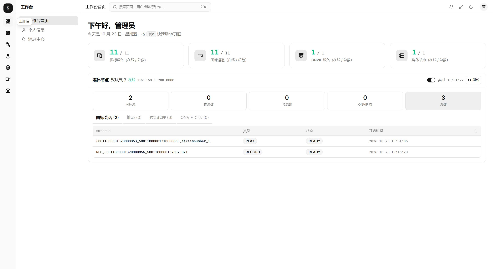

### 国标设备管理

设备注册状态、在线 / 离线、网络地址、最近心跳一目了然，点击任意设备在右侧检视器中查看详情。

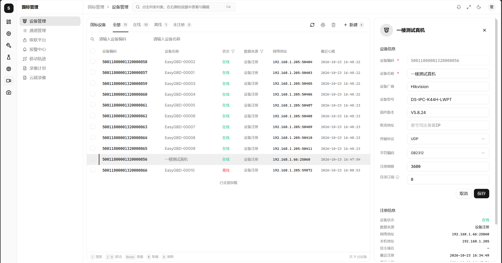

### 通道管理

按设备分组管理所有国标通道，支持通道名称、编码、云台类型、数据来源等多维度筛选。

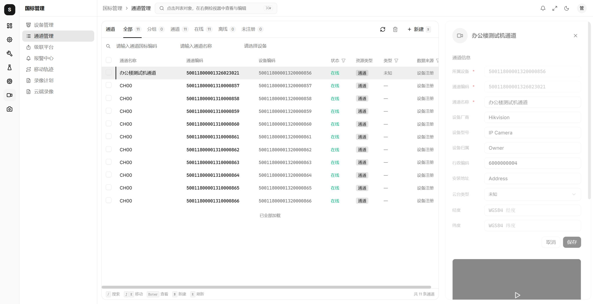

### 录像计划

按周编排录制时段（支持 7×24 全时段与跨午夜时段），TCP 主动 / 被动收流、主辅码流可配，保留天数自动清理。

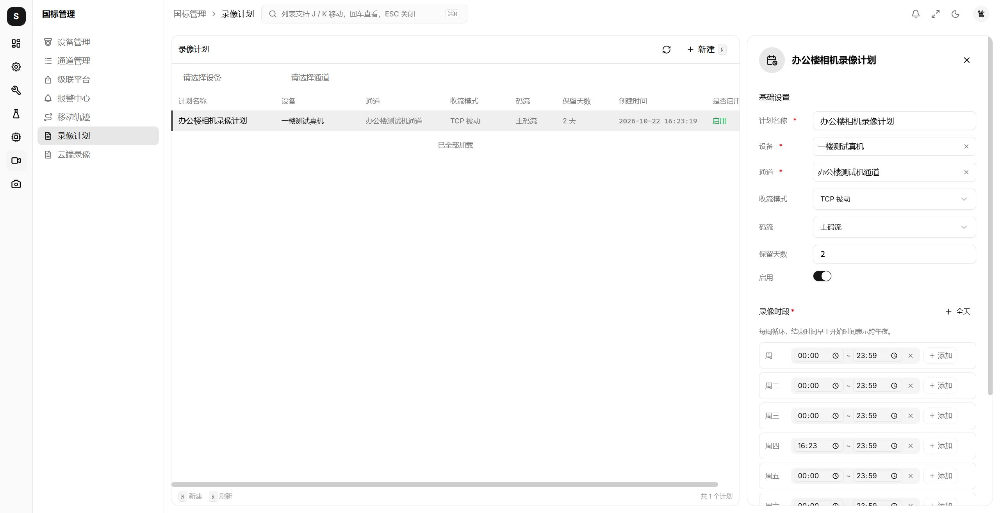

### 云端录像中心

MP4 切片自动上传对象存储，按设备 / 通道 / 时间 / 状态多维检索，直接在线播放与下载。

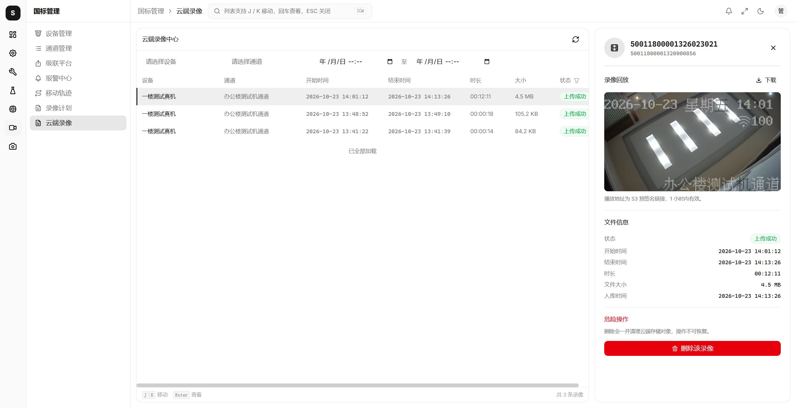

### 国标级联

支持上级平台与下级平台双向级联：作为下级向上级注册共享目录，作为上级接入下级平台并订阅目录变化。

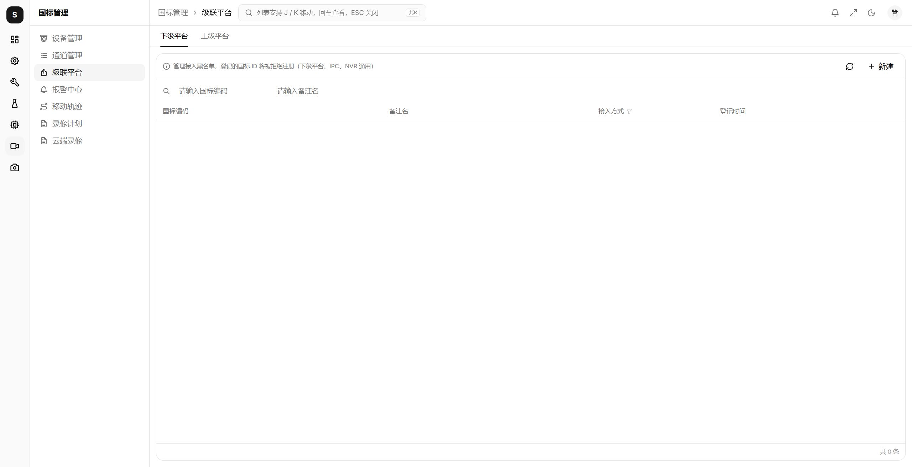

### 报警中心

统一接收设备报警事件（移动侦测、视频遮挡、硬盘满等），按时间 / 设备 / 报警类型过滤查询。

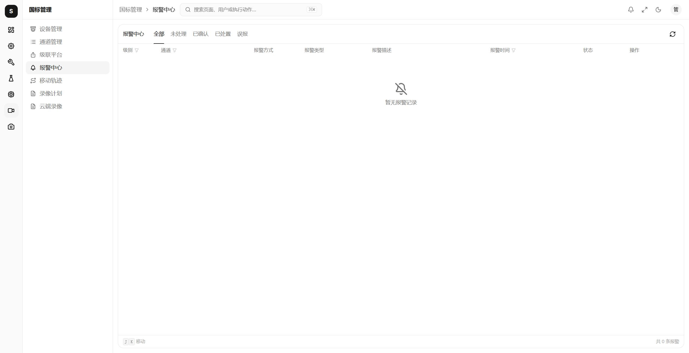

### 流媒体节点管理

多 ZLMediaKit 节点统一管理，支持在线状态、心跳检测、负载均衡调度。

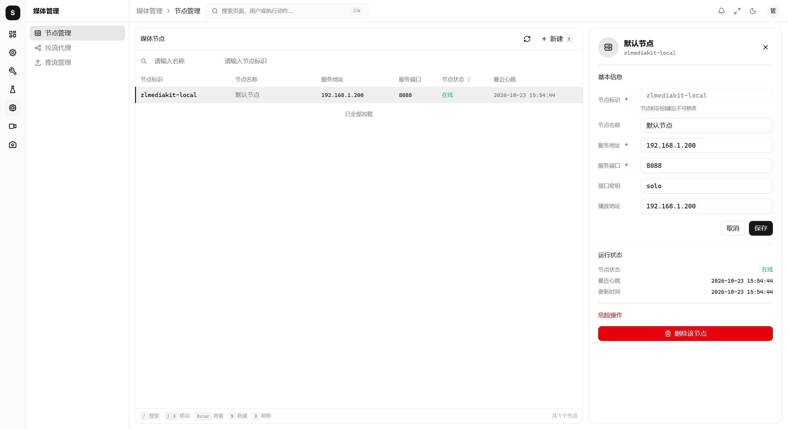

### 拉流代理

一键拉取外部 RTSP / RTMP / FLV / HLS 流到平台分发，自动转封装输出多协议播放地址。

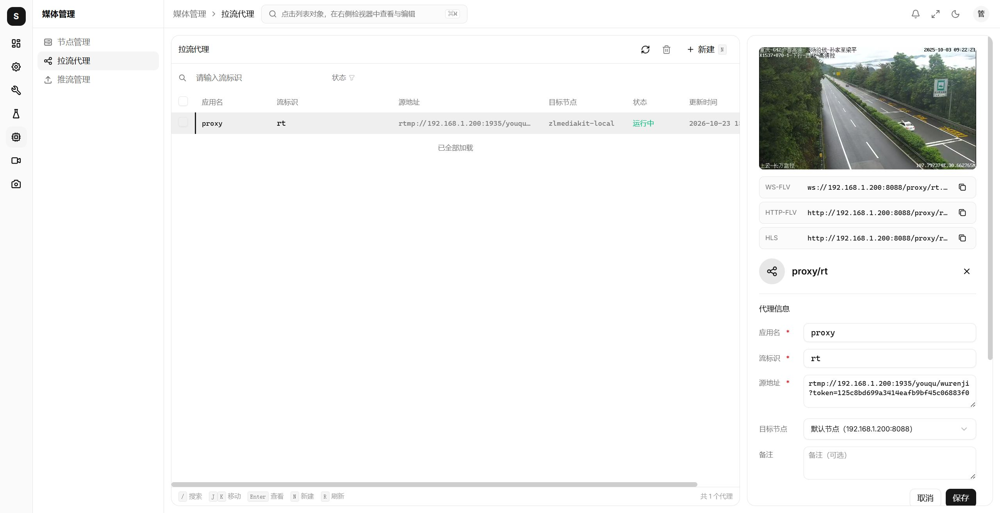

### 推流管理

第三方推流接入与授权管理，支持 RTMP 推流实时监控与鉴权。

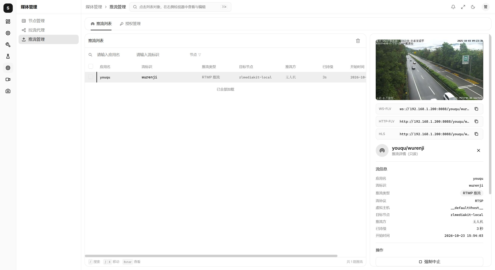

### ONVIF 设备接入

自动发现与手动添加 ONVIF 协议设备，自动探测 RTSP 流地址并转封装分发，支持鉴权配置。

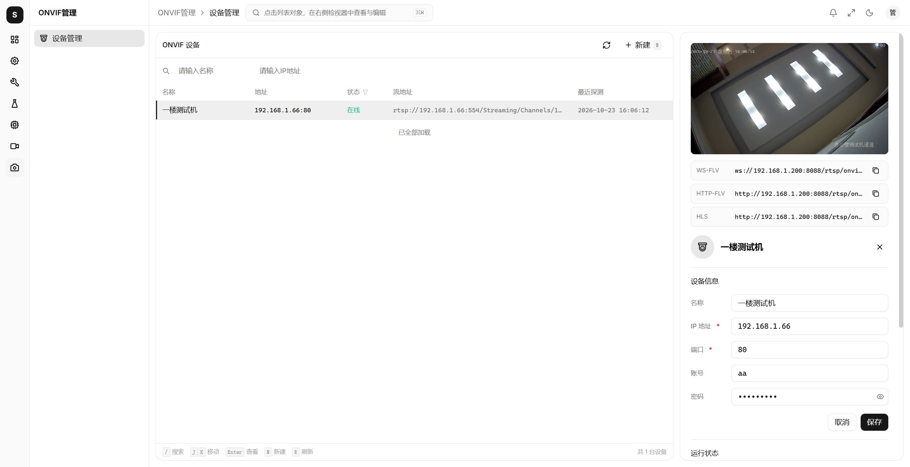

> 此外还提供 **移动轨迹（GPS）**、**云台控制（含预置位 / 巡航）**、**录像回放与倍速下载**、**RBAC 权限管理**、**操作日志**、**Web SSH**、**站内消息** 等功能模块，可本地启动后逐一体验。

## 定位与边界

Solo 定位为**视频能力底座（中台）**：专注把 GB/T 28181 设备接入与流媒体分发封装成稳定、标准化的 **REST API + WebSocket + 标准播放地址（HTTP-FLV / WS-FLV / HLS / WebRTC）**，供上层业务系统集成。它是一个"能力提供方"，而不是一个开箱即用的行业业务成品。

**平台提供（底座职责内）**

- 设备注册鉴权、目录同步、实时点播、录像回放 / 下载、云台控制、报警事件、GPS 移动位置、语音广播、国标级联
- 多流媒体节点负载均衡、拉流代理、推流鉴权
- RBAC 权限、操作日志、Web SSH、对象存储文件等系统支撑能力

**平台不做（由业务系统自行实现）**

- **监控大屏、电子地图打点 / 轨迹可视化**等呈现层
- **多画面分屏、电视墙、分组轮巡**等播放编排
- 人脸识别、客流统计、智能分析等行业业务逻辑
- 面向具体客户的业务流程与页面定制

> 业务系统无需关心 SIP 信令与设备差异，直接调用平台接口获取播放地址、订阅报警 / 状态事件即可完成自身业务闭环。

## 功能特性

### 视频监控（GB/T 28181 国标）

- **设备接入**：SIP 注册（RFC 2617 Digest 完整 qop=auth 鉴权，兼容海康/大华/宇视/华为）、心跳保活、在线状态实时维护（Redis TTL + 定时对账）
- **通道目录**：注册后自动拉取 Catalog，分片合并入库，支持超大目录；设备信息（厂商/型号/固件）自动同步
- **实时点播**：主/子码流切换，UDP / TCP 被动 / TCP 主动三档收流；HTTP-FLV / WS-FLV / HLS / WebRTC 多协议播放；按需拉流（无观看自动断流节能）
- **历史回放**：录像检索、时间轴回放、暂停 / 续播 / 拖动 / 倍速（SIP INFO + MANSRTSP）
- **录像下载**：DOWNLOAD INVITE 倍速下载，MP4 落对象存储，预签名 URL 直接下载，失败自动重试
- **云端录像**：按通道配置周计划（支持 7×24、跨午夜时段），定时对账自动拉起 / 停止录制，MP4 切片经 hook 自动上传对象存储；云端录像中心支持按设备 / 通道 / 时间 / 状态检索、在线回放、预签名下载、保留期自动清理；READY 会话周期性探测 ZLM 真实录制态（isRecording），外部误调 stopRecord 或 ZLM 丢录制态时自动补发 startRecord
- **云台控制**：八方向 + 变倍 + 聚焦 + 光圈 + 雨刷；预置位管理；巡航路线（巡航点编排、速度/停留时间、启停）；拉框放大/缩小（画面上直接框选）、看守位（预置位面板内设置）
- **设备控制**：布防 / 撤防、报警复位、设备本地录像开关、强制关键帧、远程重启（重启单独授权）
- **报警中心**：报警落库 + WebSocket 实时推送，支持前端处置闭环
- **移动位置**：GPS 位置上报解析、事件总线、轨迹点异步落库、历史轨迹查询与保留期清理
- **语音广播**：浏览器麦克风经 WebRTC 实时喊话，平台发广播通知后接收设备反向 INVITE，音频按设备协商的 PCMA/PS 载荷裸 RTP 推送给设备放音；兼容反向 INVITE 不带 Subject 的设备（如海康），UDP / TCP 主动 / TCP 被动三种传输自适应
- **主动检测**：设备存活 fire-and-forget 探测，三态回调校准在线状态

### 国标级联

- **作为上级**：下级平台白名单管理，下级注册后视为设备接入，通道目录自动入库、按周期发起目录订阅并自动续期，可直接点播 / 回放下级通道
- **作为下级**：注册保活到上级平台（401 Digest 应答、掉线自动重注册），资源共享目录树勾选推送，响应上级 Catalog / DeviceInfo / DeviceStatus 查询（分片）；接收上级目录 / 移动位置 / 报警订阅（SUBSCRIBE）并维护订阅状态，目录变化、GPS 位置、报警均主动 NOTIFY 推送、支持手动主动推送；被上级点播时经 ZLM sendRtp 主动推流；上级 DeviceControl 控制指令（PTZ 云台 / 布防 / 报警复位 / 录像 / 强制关键帧 / 远程启动 / 拉框放大缩小 / 看守位）经共享校验后透传给真实设备

### 流媒体（ZLMediaKit 集成）

- **多节点负载均衡**：Redis ZSet 按活跃流数智能选点，SSRC 池 Redis 化，多实例部署安全
- **拉流代理**：外部 RTSP/RTMP 流拉入 ZLM 转推，启停管理、播放地址自动生成
- **推流管理**：推流只读视角 + 推流方 token 鉴权，僵尸流自动对账清理
- **自动点播**：播放地址被访问但流不存在时自动补发 INVITE

### 系统底座（RBAC）

- 用户 / 角色 / 菜单**按钮级权限**，JWT 双 Token 认证，首次登录强制改密
- 数据字典、参数配置、操作日志（`@OperationLog` 注解）、登录在线用户管理
- 服务器管理：**Web SSH 终端**（JSch + xterm.js）、服务器监控
- 文件管理：基于 RustFS 的对象存储统一接入（S3 协议，可替换为 OSS/COS/OBS 等）
- 站内消息：WebSocket 实时推送
- 限流、防重复提交、XSS 消毒等 AOP 安全能力

### ONVIF 模块

ONVIF 摄像头维护与实时点播，手写 SOAP（dom4j + Java 21 HttpClient），无 JAX-WS 历史包袱。

## 前端说明

前端代码位于本仓库 `solo-ui/` 目录：Vue 3.5 + TypeScript + Vite 6 + Tailwind CSS 4 + shadcn-vue (reka-ui) + Pinia，现代极简风格，覆盖国标设备/通道/级联、点播回放、流媒体节点、拉流代理、推流、ONVIF、RBAC、Web SSH、消息中心、系统设置等全部能力，开发端口 `5173`。

## 技术栈

| 端 | 技术 |
|---|---|
| 后端 | Spring Boot 4.1 · Java 21 · MyBatis-Plus 3.5 · JAIN-SIP · jjwt · dom4j · JSch |
| 前端 | Vue 3.5 · TypeScript 5.7 · Vite 6 · Tailwind CSS 4 · shadcn-vue / reka-ui · Pinia · xterm.js · Jessibuca / mpegts.js |
| 基础设施 | MySQL 8 · Redis 6+ · ZLMediaKit · RustFS（S3 兼容对象存储） |

## 快速开始

### 环境要求

- JDK 21+、Maven 3.8+、Node.js 18+、MySQL 8+、Redis 6+
- ZLMediaKit（视频功能必需，可用 Docker 部署）
- RustFS（S3 兼容对象存储，录像下载 / 文件管理必需；亦可使用其他 S3 兼容实现）

### 1. 初始化数据库

三个脚本共用同一个 MySQL 库，按需安装：

```bash
mysql -uroot -p < sql/solo_db.sql     # 必装（系统 + 权限）
mysql -uroot -p < sql/gb28181.sql     # 国标模块
mysql -uroot -p < sql/onvif.sql       # ONVIF 模块（可选）
```

### 2. 配置并启动后端

编辑 `solo/src/main/resources/application.yaml`：

- `spring.datasource` / `spring.data.redis`：数据库与 Redis 连接
- `gb28181.*`：SIP 端口（默认 5060）、平台国标编码、域、注册密码
- `media.*`：ZLM 节点地址 / 密钥 / 点播超时 / SSRC 段
- `s3.*`：RustFS 的 endpoint、`access-key` / `secret-key`、`bucket`（默认 `path-style-access=true`）

```bash
cd solo && ./mvnw spring-boot:run
```

服务端口 `8080`，SIP 同时监听 UDP/TCP `5060`，等待 ZLM hook 回调。

### 3. 配置并启动 ZLMediaKit

仓库提供一份开箱参考配置 [zlm/config.ini](zlm/config.ini)，复制到 ZLM 的配置目录（与 `MediaServer` 可执行文件同级的 `conf/`）后按需修改三处：

- **Hook 回调地址**：以 `on_stream_changed` 为例，完整写法为 `http://solo.com:8080/api/hook/on_stream_changed?secret=solo`；请将 `solo.com` 改为后端实际可达地址（本地联调可在 hosts 中把 `solo.com` 指向后端 IP），其余 `on_*` 事件同理。**secret 必须作为 URL 查询参数（`?secret=`）带上**，且与本文件 `[api].secret`、后端 `media.hook-secret`（统一 `solo`）三者一致，否则后端 `checkSecret` 会拒绝回调。
- **API 密钥**：`[api].secret` 须与后端媒体节点的 `secret` 一致（示例值 `solo`，生产环境请更换）。
- **节点标识**：`[general].mediaServerId`（示例 `zlmediakit-local`）须与后端媒体节点的 `server-id` 完全一致。

关键端口（需与后端媒体节点配置、防火墙放行对应）：

| 端口 | 用途 |
|---|---|
| `8088` | HTTP API / HTTP-FLV / WS-FLV / HLS |
| `554` | RTSP |
| `1935` | RTMP |
| `8000` | WebRTC（TCP/UDP） |
| `10000` | RTP 代理端口（国标 PS 流转发） |
| `9000` | SRT |

> 另需保证 ZLM 所在机器安装了 ffmpeg（示例中 `[ffmpeg].bin=/usr/bin/ffmpeg`，Linux 路径；Windows 请改为实际路径）。

### 4. 启动前端

```bash
cd solo-ui && npm install && npm run dev
```

访问 `http://127.0.0.1:5173`，`/api` 已代理到 `localhost:8080`。本地体验账号 `admin / admin123`（**生产环境请务必修改默认密码**）。

### 5. 接入摄像头

将国标设备（海康/大华/宇视等）的 SIP 服务器指向部署机 `IP:5060`，协议 ID 填 `application.yaml` 中的 `gb28181.id`。设备注册成功后平台自动拉取通道目录，即可点播。

## 开放 API 对接指南（第三方）

平台通过开放 API 向第三方业务系统提供国标能力（当前开放**实时点播**：开始 / 停止）。接口采用 HMAC-SHA256 签名鉴权，无需登录态，适合服务端对接。

### 1. 申请凭证

平台方在管理后台「开放平台 → 应用管理」创建应用后，第三方获得：

| 凭证 | 说明 |
|---|---|
| `appKey` | 应用标识，类似用户名，随每个请求传递 |
| `appSecret` | 签名密钥，**只在创建 / 换钥时展示一次**，平台仅存密文，丢失只能换钥 |

创建时需让平台方：授权 scope `gb:play:write`（点播接口必需）、按需配置 IP 白名单（留空表示不限制）。

### 2. 请求约定

- 基地址：`http://{平台IP}:8080`，全部 `POST` + `application/json; charset=utf-8`
- 每个请求必须携带以下请求头：

| 请求头 | 必填 | 说明 |
|---|---|---|
| `X-App-Key` | 是 | 应用 appKey |
| `X-Timestamp` | 是 | 调用时刻的 **Unix 秒级时间戳**（毫秒也兼容），与服务端偏差超过 **300 秒**拒绝（40104） |
| `X-Nonce` | 是 | 每次请求随机生成的唯一串，**同一 nonce 10 分钟内只能用一次**，重复拒绝（40105） |
| `X-Sign-Alg` | 是 | 固定 `HMAC-SHA256` |
| `X-Signature` | 是 | 签名值，**小写 HEX**，算法见下 |
| `X-Request-Id` | 否 | 调用方自己的请求追踪 ID，响应头与响应体中原样回显，方便对账排障 |

### 3. 签名算法（HMAC-SHA256）

**第 1 步：规范化 query**

没有 query 时为空串 `""`。有 query 时按参数名 ASCII 字典序排列，参数值做 URL 编码，用 `&` 拼接：`k1=v1&k2=v2`。

**第 2 步：计算请求体摘要**

对**实际发送的原始 body 字节**（UTF-8）算 SHA-256，输出小写 HEX。body 为空时对空串计算。

> 关键：参与哈希的 body 必须与实际发送的字节**逐字节一致**（含空格、换行）。所以应当先定稿 body，再算哈希，之后不要再改写、重排版 body。

**第 3 步：拼接待签名串**（6 行，行间是 `\n`）

```
METHOD          // HTTP 方法大写，如 POST
PATH            // 路径，不含域名、不含 query，如 /open-api/v1/play/start
CANONICAL_QUERY // 第 1 步结果，无 query 时为空行
BODY_SHA256     // 第 2 步结果
TIMESTAMP       // 与 X-Timestamp 完全一致
NONCE           // 与 X-Nonce 完全一致
```

**第 4 步：算签名**

```
X-Signature = lower_hex( HMAC_SHA256(待签名串, appSecret) )
```

### 4. 统一响应与错误码

所有响应都是同一信封（包括业务失败）：

```json
{ "code": 200, "message": "success", "data": { }, "requestId": "调用方传入或平台生成" }
```

HTTP 状态码与业务码 `code` 需同时判断。常见错误码：

| HTTP | code | 含义 | | HTTP | code | 含义 |
|---|---|---|---|---|---|---|
| 401 | 40101 | 缺少鉴权信息 | | 403 | 40303 | 应用未授权该接口（scope） |
| 401 | 40102 | 应用不存在 | | 403 | 40304 | 来源 IP 不在白名单 |
| 401 | 40103 | 签名校验失败 | | 400 | 40001 | 请求参数不合法 |
| 401 | 40104 | 时间戳过期 | | 400 | 40003 | 设备不存在 |
| 401 | 40105 | 重复请求（nonce） | | 400 | 40004 | 设备 / 通道不在线 |
| 403 | 40301 | 应用已停用 | | 429 | 42901 / 42902 | 触发 QPS / 日调用量限制 |
| 403 | 40302 | 应用已过期 | | 200 | 60001 / 60002 | 点播失败（设备未响应/拒绝）/ 流不存在 |

> 注意：国标业务类失败（60001 等）HTTP 状态仍是 200，靠 `code` 区分。设备不在线时点播返回 40004。

### 5. 最快上手：用 Bruno 调通（以「开始点播」为例）

仓库已提供 Bruno 集合前置脚本：[`openapi/pre-script.js`](openapi/pre-script.js)。它会在每次点击 Send 时自动生成时间戳、nonce 并完成签名，**不用手工算签名，也不用担心时间戳过期和 nonce 重复**。

**① 新建 Collection 与环境变量**

Bruno 中新建 Collection，再新建一个 Environment（如 `local`），配置三个变量：

| 变量 | 示例值 |
|---|---|
| `base_url` | `http://localhost:8080` |
| `app_key` | 平台分配的 ak_xxx |
| `app_secret` | 平台分配的密钥（明文，只存在你本地 Bruno 环境里） |

并选中该环境（右上角环境切换器）。

**② 粘贴前置脚本**

打开 Collection 设置 → Pre-request Script，把 [`openapi/pre-script.js`](openapi/pre-script.js) 的全部内容粘贴进去。脚本对集合内所有请求自动生效，会自动写入 6 个鉴权头。

**③ 新建「开始点播」请求**

- 方法：`POST`
- URL：`{{base_url}}/open-api/v1/play/start`
- Body 选 JSON：

```json
{
  "deviceId": "34020000001320000001",
  "channelId": "34020000001320000001",
  "transport": "TCP-passive",
  "streamNumber": null
}
```

字段说明：`deviceId` / `channelId` 为 20 位国标 ID（向平台方索取）；`transport` 支持 `TCP-passive`（默认）/ `UDP`；`streamNumber` **显式传 `null` = 主码流**，不传或传 `"streamnumber:1"` = 子码流。

**④ 点击 Send**

成功响应（`code=200`）：

```json
{
  "code": 200,
  "message": "success",
  "data": {
    "streamId": "34020000001320000001_34020000001320000001",
    "app": "rtp",
    "mediaServerId": "zlmediakit-local",
    "ssrc": "0000001430",
    "rtpPort": 30660,
    "transport": "TCP-passive",
    "streamNumber": null,
    "flvUrl": "http://192.168.1.200:8088/rtp/34020000001320000001_34020000001320000001.live.flv",
    "wsFlvUrl": "ws://192.168.1.200:8088/rtp/34020000001320000001_34020000001320000001.live.flv",
    "hlsUrl": "http://192.168.1.200:8088/rtp/34020000001320000001_34020000001320000001/hls.m3u8",
    "rtcUrl": ""
  },
  "requestId": "a1b2c3d4..."
}
```

拿到 `streamId` 和播放地址后即可拉流（HTTP-FLV / WS-FLV / HLS / WebRTC）。

**⑤ 停止点播**（不看时务必调用，释放设备会话与收流端口；接口幂等，重复调用仍返回成功）

- `POST {{base_url}}/open-api/v1/play/stop`

```json
{ "streamId": "34020000001320000001_34020000001320000001" }
```

**排查提示**：底部 Console 面板会打印本次的待签名串和 body；返回 40103 时先对比服务端日志（每次调用平台侧都有 `[openapi接口调用]` 记录，含业务码与耗时）。

### 6. 不用 Bruno 时（curl / openssl 验证算法）

```bash
APP_KEY=ak_xxx
APP_SECRET=平台分配的密钥
TS=$(date +%s)
NONCE=$(openssl rand -hex 16)
BODY='{"deviceId":"34020000001320000001","channelId":"34020000001320000001","transport":"TCP-passive","streamNumber":null}'

BODY_HASH=$(printf '%s' "$BODY" | openssl dgst -sha256 -hex | sed 's/^.*= //')
SIGN_STR=$(printf 'POST\n/open-api/v1/play/start\n\n%s\n%s\n%s' "$BODY_HASH" "$TS" "$NONCE")
SIGNATURE=$(printf '%s' "$SIGN_STR" | openssl dgst -sha256 -hmac "$APP_SECRET" -hex | sed 's/^.*= //')

curl -X POST "http://localhost:8080/open-api/v1/play/start" \
  -H "Content-Type: application/json" \
  -H "X-App-Key: $APP_KEY" -H "X-Timestamp: $TS" -H "X-Nonce: $NONCE" \
  -H "X-Sign-Alg: HMAC-SHA256" -H "X-Signature: $SIGNATURE" \
  -d "$BODY"
```

### 7. 对接注意事项

- **禁止重放同一签名请求**：超时重试必须重新生成时间戳和 nonce、重新签名，直接重发旧请求会收到 40105。
- **先定稿 body 再签名**：签名后不得再修改 JSON 排版；GET 类请求 body 摘要为空串。
- **密钥轮换**：平台换钥后旧密钥有过渡期（默认 24 小时），过渡期间新旧密钥都可验签，第三方应在过渡期内完成切换。
- **限流**：QPS 与日调用量在应用上配置，超限分别返回 42901 / 42902（鉴权未通过的请求不占配额）。
- **故障排查**：每次请求平台都会记录调用日志（appKey、requestId、IP、耗时、HTTP/业务码、错误原因），在管理后台「开放平台 → 调用日志」可查；报障时提供 `X-Request-Id` 可快速定位。

## 项目结构

```
solo-platform/
├── solo/                  # Spring Boot 后端（端口 8080）
│   └── src/main/java/com/solo/
│       ├── system/        # RBAC / 字典 / 文件 / 消息 / 日志 / 服务器
│       ├── gb28181/       # 国标 SIP 协议栈与设备/级联/回放/云台业务
│       ├── media/         # ZLM 客户端 / Hook / SSRC 池 / 拉流代理 / 推流
│       ├── onvif/         # ONVIF 摄像头
│       ├── openapi/       # 开放 API（HMAC 签名鉴权 / 应用管理 / 实时点播 / 调用审计）
│       ├── aop/           # 权限 / 操作日志 / 限流 / 防重复提交
│       ├── config/        # JWT / Redis / MyBatis-Plus / 安全头
│       └── websocket/     # 消息推送 / Web SSH 终端
├── openapi/               # 第三方对接资料（Bruno 前置签名脚本，见上方对接指南）
├── solo-ui/               # Vue 3 控制台（Vite + Tailwind + shadcn-vue，端口 5173）
├── zlm/                   # ZLMediaKit config.ini 示例（hook / 端口 / 录像参考配置）
└── sql/                   # 数据库初始化脚本（solo_db / gb28181 / onvif）
```


## 国标不计划实现清单

> 记录 GB/T 28181 标准中有定义、但本项目不计划实现的能力，并说明原因。
> 后续有新的决策可继续补充到本表。

| 功能 | 说明 | 未实现原因 |
|---|---|---|
| 配置查询与下发(DeviceConfig) | 远程查询或修改设备视频参数、OSD、网络、云台等配置 | 各厂商差异大、兼容性差；远程改网络/端口风险高 |
| ConfigDownload 配置下载 | 下载设备完整配置文件，用于备份/恢复/克隆 | 各厂商 schema 不兼容、跨品牌无法复用 |
| Query/Alarm 报警查询 | 平台主动向设备查询历史报警记录 | 报警靠 Notify 推送、平台已有报警库 |
| 报警主动订阅 | 平台主动向设备发起报警订阅，约定有效期和上报方式 | 明确不做。主流设备默认 Notify 即能收到 |

## 路线图

### 已完成

- [x] 设备注册鉴权 / 目录同步 / 实时点播 / 录像回放下载 / 云台（预置位 + 巡航）
- [x] 报警落库 + WebSocket 实时推送
- [x] GPS 移动位置落库、历史轨迹查询与保留期清理（轨迹可视化由业务系统实现）
- [x] 国标级联（作为上级 / 作为下级，目录共享、订阅推送、被点播推流、上级 DeviceControl 透传）
- [x] 云台拉框缩放 / 看守位（后端接口 + 前端入口）
- [x] 多 ZLM 节点负载均衡 / SSRC Redis 化 / 拉流代理 / 推流鉴权
- [x] ONVIF 摄像头接入与点播
- [x] RBAC 权限底座、Web SSH、站内消息、S3 文件管理
- [x] **录像计划**：按通道配置周计划（7×24 / 跨午夜时段），每分钟对账自动拉起、断流重拉、过时段停止
- [x] **云端录像中心**：MP4 切片 hook 自动上传对象存储，设备 / 通道 / 时间 / 状态检索、在线回放、预签名下载、保留期自动清理、录制态探测补偿
- [x] **语音广播**：网页麦克风 WebRTC 喊话，广播通知 + 设备反向 INVITE，裸 PCMA/PS 推流放音，UDP/TCP 自适应
- [x] **开放 API**：第三方 HMAC-SHA256 签名鉴权接入，应用授权 / IP 白名单 / 限流 / 换钥过渡期 / 调用审计日志，已开放实时点播接口
- [x] 全新 shadcn 风格控制台（`solo-ui/`，Vue 3 + Tailwind + shadcn-vue）

### 规划中

- [ ] **语音对讲**：广播基础上的双向语音（设备音频回传网页侧播放）
- [ ] **云端录像截图抓拍**：录像封面图 / 时间点抓拍
- [ ] **流保活（touch）**：播放端定期心跳保活，避免页面刷新/网络抖动导致流频繁断连重连
- [ ] **数据库迁移**：引入 Flyway/Liquibase，提供生产平滑升级路径
- [ ] **集群高可用**：下载任务 / 订阅状态分布式化，支持多副本部署


## 致谢与署名声明

本项目的 GB/T 28181 协议实现在架构设计与领域命名上参考了开源项目 [WVP-GB28181-pro](https://github.com/648540858/wvp-GB28181-pro)（MIT License，Copyright © 2020 swwhaha）：

- 参考范围仅限于协议处理分层、类 / 方法命名等设计思路，以便与国标文档及社区实践对照；
- 本项目**未包含** WVP-GB28181-pro 的任何源代码，全部代码均为基于 Spring Boot 4 / Java 21 的独立实现。

流媒体能力基于 [ZLMediaKit](https://github.com/ZLMediaKit/ZLMediaKit)（C++ 流媒体服务器，通过 REST / Hook 方式集成，未包含其源码）；前端基于 shadcn-vue 设计体系。

## License

[MIT License](LICENSE)
